# 🎧 SONIC_LAB — Sound Kit Marketplace & Producer Terminal

<p align="center">
  <!-- IMAGEM: Banner Principal ou Mockup Geral do Projeto -->
  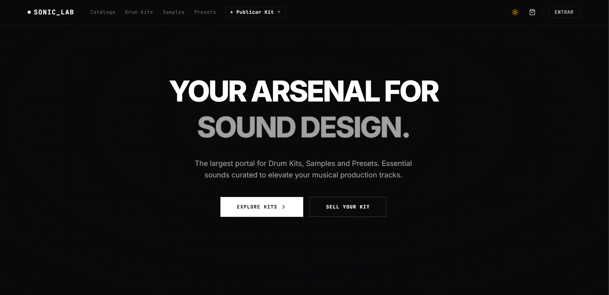
</p>

<p align="center">
  <strong>Marketplace brutalista de alta performance e terminal de produção musical para sound designers independentes.</strong>
</p>

<p align="center">
  
  
  
  
  
  
</p>

---

## 📌 Sumário

1. [Sobre o Projeto](#-sobre-o-projeto)
2. [Demonstração Visual](#-demonstração-visual)
3. [Stack Tecnológica](#-stack-tecnológica)
4. [Arquitetura & Resiliência](#-arquitetura--resiliência)
5. [Funcionalidades e Telas](#-funcionalidades-e-telas)
6. [Instalação e Execução](#-instalação-e-execução)
7. [Variáveis de Ambiente](#-variáveis-de-ambiente)
8. [Estrutura de Pastas](#-estrutura-de-pastas)
9. [Licença](#-licença)

---

## 📖 Sobre o Projeto

O **SONIC_LAB** é uma plataforma e marketplace web moderna desenvolvida para produtores musicais, beatmakers e sound designers. Com uma estética brutalista-minimalista refinada, o projeto combina navegação ágil, interações visuais fluidas e recursos de áudio em tempo real para comercialização e teste de pacotes de som (*Drum Kits*, *Sample Packs*, *Preset Banks* para sintetizadores e *MIDI Kits*).

### Principais Destaques:
- **Design Brutalista & Alta Performance**: Tipografia marcante (*PP Neue Corp Wide*, *JetBrains Mono*, *Inter*), contraste afiado e transições sem engasgos.
- **Player de Áudio Global Persistente**: Barra de reprodução acoplada com renderização de waveform em tempo real via HTML5 Canvas, scrubber de tempo e atalho universal via teclado (`Espaço`).
- **Suporte Nativo a Temas (Claro & Escuro)**: Alternância de tema síncrona, persistida no `localStorage` e livre de falhas visuais.
- **Dual-Mode Resiliente**: Comunicação completa com backend Spring Boot REST API via tokens JWT, com **modo de simulação offline automático** em caso de indisponibilidade do servidor.

---

## 📸 Demonstração Visual

<!-- IMAGEM: Grade ou GIF mostrando a aplicação em funcionamento -->
<p align="center">
  
</p>

### 🌓 Alternância de Tema (Modo Claro vs Modo Escuro)
| Modo Escuro (Padrão) | Modo Claro |
| :---: | :---: |
| <!-- IMAGEM: Captura de tela do Modo Escuro --> 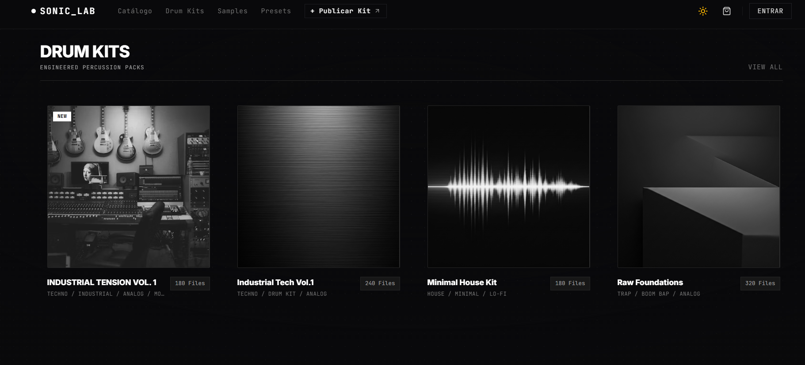 | <!-- IMAGEM: Captura de tela do Modo Claro --> 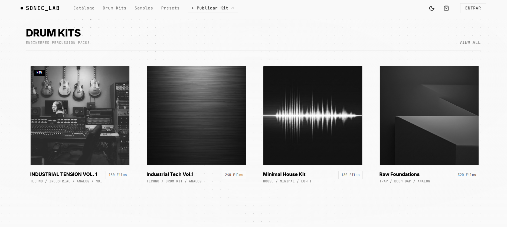 |

---

## 🛠️ Stack Tecnológica

### Core & Framework
- **[React 19](https://react.dev/)**: Biblioteca base para construção da interface declarativa com hooks modernos.
- **[TypeScript 5.8](https://www.typescriptlang.org/)**: Tipagem estática rigorosa para garantir segurança e previsibilidade no código.
- **[Vite 6](https://vitejs.dev/)**: Ferramenta de build e servidor de desenvolvimento ultra-rápido com proxy reverso integrado.

### Estilização & UI
- **[Tailwind CSS v4](https://tailwindcss.com/)**: Motor de estilos CSS-first com variáveis nativas (`@theme`), variantes `@custom-variant dark` e tokens semânticos de cores.
- **[Lucide React](https://lucide.dev/)**: Conjunto de ícones leves e consistentes para ações e status.
- **Fontes Customizadas**: *PP Neue Corp Wide* (títulos em display), *JetBrains Mono* (dados técnicos e códigos) e *Inter* (corpo de texto).

### Animações & Interatividade
- **[Motion (antigo Framer Motion)](https://motion.dev/)**: Animações fluidas entre páginas e controle de modais (`AnimatePresence`).
- **[GSAP 3](https://gsap.com/) & [Lenis](https://lenis.darkroom.engineering/)**: Scroll suave com camadas de paralaxe e aceleração por hardware.
- **Interactive Canvas SonarGrid**: Malha de pontos estilo radar militar reativa aos movimentos do cursor e ondas de clique.
- **Shader FX ([@paper-design/shaders](https://www.npmjs.com/package/@paper-design/shaders))**: Efeitos visuais analógicos e texturas metálicas líquidas.

### Áudio & Síntese
- **HTML5 Web Audio API**: Decodificação de arquivos de áudio, reprodução com timeupdate e controle de ganho.
- **Interactive Waveform Canvas**: Visualizador em barras dinâmicas de 100 pontos para visualização precisa da dinâmica das faixas.
- **Gerador Sintético de WAV (16-bit PCM)**: Utilitário para sintetizar batidas de bateria e instrumentos localmente para testes rápidos de upload.
- **Gerador de Capas em Canvas**: Utilitário para gerar artes de capas em JPEG com gradientes e tipografia sem necessidade de upload externo.

---
---

## 🚀 Funcionalidades e Telas

### 1. Página Inicial (Home)
<!-- IMAGEM: Screenshot da Home / Hero Section -->
<p align="center">
  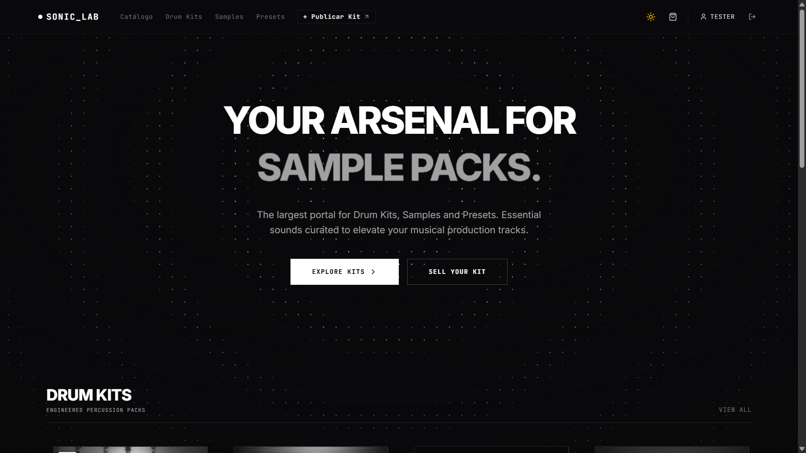
</p>
- Hero com tipografia brutalista e disco de vinil giratório interativo.
- Vitrine de novidades e kits em destaque com preview direto em waveform.
- Navegação direta para seções de Drum Kits, Samples e Presets.

### 2. Catálogo Completo de Kits
<!-- IMAGEM: Screenshot do Catálogo com Filtros -->
<p align="center">
  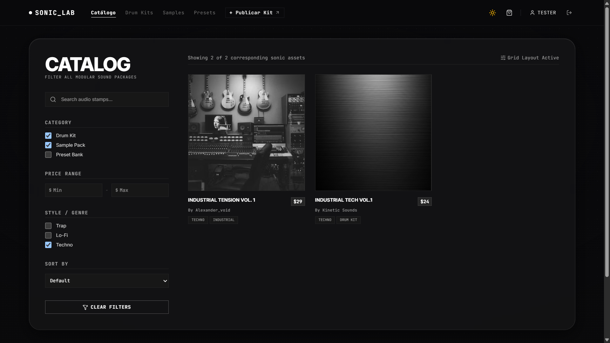
</p>
- Campo de pesquisa em tempo real por título, descrição e tags.
- Filtros por categoria: *Drum Kit*, *Sample Pack*, *Preset Bank* e *MIDI Kit*.
- Filtros por tags dinâmicas e controle de intervalo de preço (mínimo e máximo).

### 3. Player Global de Áudio & Waveform
<!-- IMAGEM: Screenshot do Player Global no rodapé -->
<p align="center">
  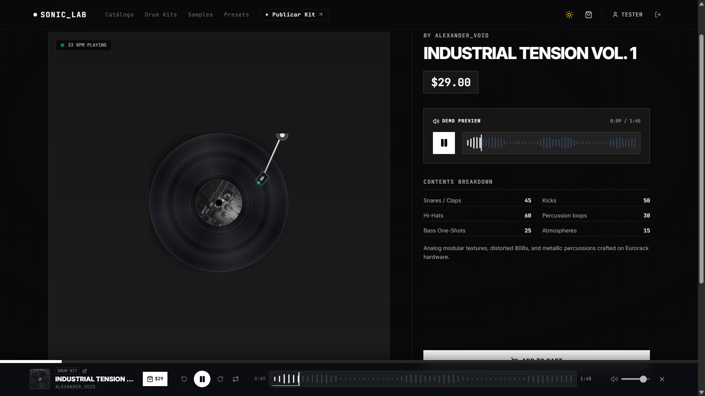
</p>
- Fixado no rodapé da aplicação, permanece ativo durante a navegação em qualquer tela.
- Visualização de amplitude waveform com scrubbing interativo.
- Atalho de teclado: pressione a barra de `Espaço` para pausar ou continuar a reprodução.

### 4. Studio do Produtor (Publicação de Kits)
<!-- IMAGEM: Screenshot da tela de Publicação / Venda de Kit -->
<p align="center">
  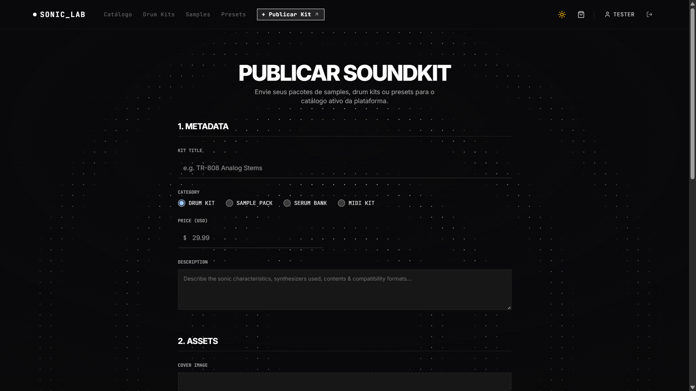
</p>
- Upload multipart de capa de álbum (JPG/PNG), áudio demo e pacote compactado em ZIP.
- Botões auxiliares de **Demo Automática**: geram um arquivo de áudio WAV 44.1kHz e uma capa artística renderizada em Canvas em 1 clique para agilizar testes.
- Definição de categorias, tags, especificações técnicas e preço.

### 5. Detalhes do Produto & Checkout
<!-- IMAGEM: Screenshot da Página de Detalhes do Kit -->
<p align="center">
  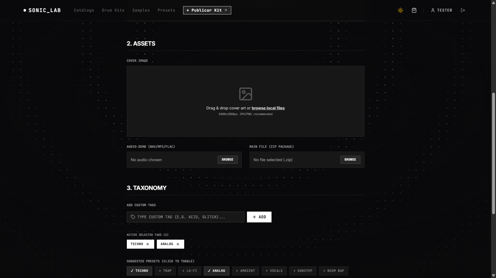
</p>
- Exibição de especificações de estúdio: taxa de amostragem, formato, tamanho e contagem de arquivos.
- Opção de adicionar ao carrinho ou realizar compra expressa (Sandbox).

### 6. Perfil do Produtor & Preferências da Conta
<!-- IMAGEM: Screenshot da aba de Configurações no Perfil -->
<p align="center">
  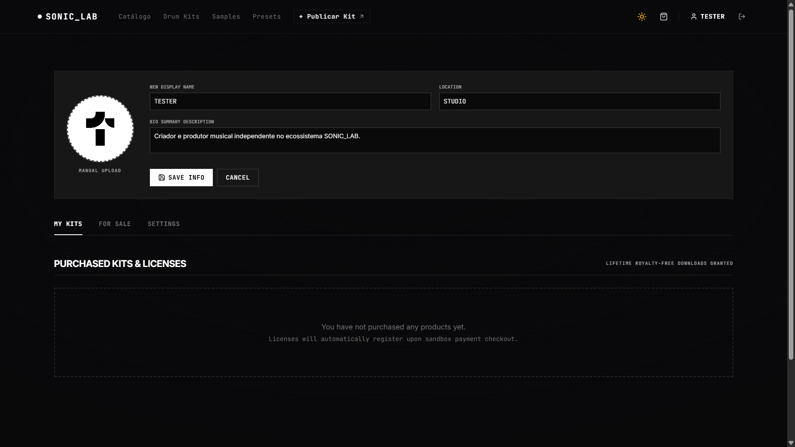
  
  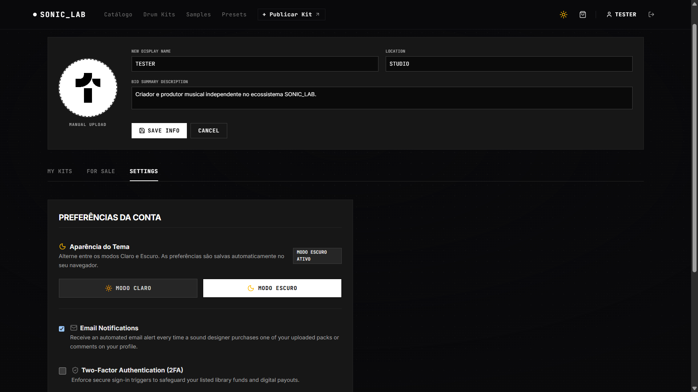
</p>
- Gestão de kits comprados com botão de download simulado em ZIP.
- Listagem dos kits publicados pelo usuário com opção de exclusão/desativação.
- Aba de **Preferências da Conta**: alternância segura entre **Modo Claro** e **Modo Escuro**, preferências de notificação por e-mail e moeda de repasse.

### 7. Gateway de Autenticação (Modal Flutuante)
<!-- IMAGEM: Screenshot do Modal de Login e Registro -->
<p align="center">
  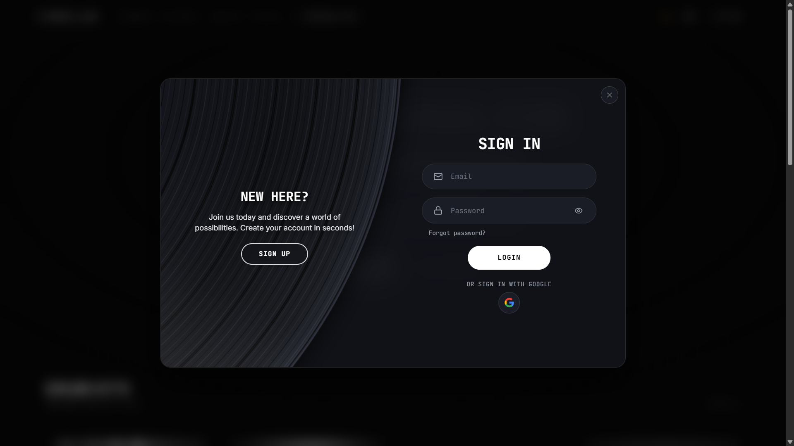
  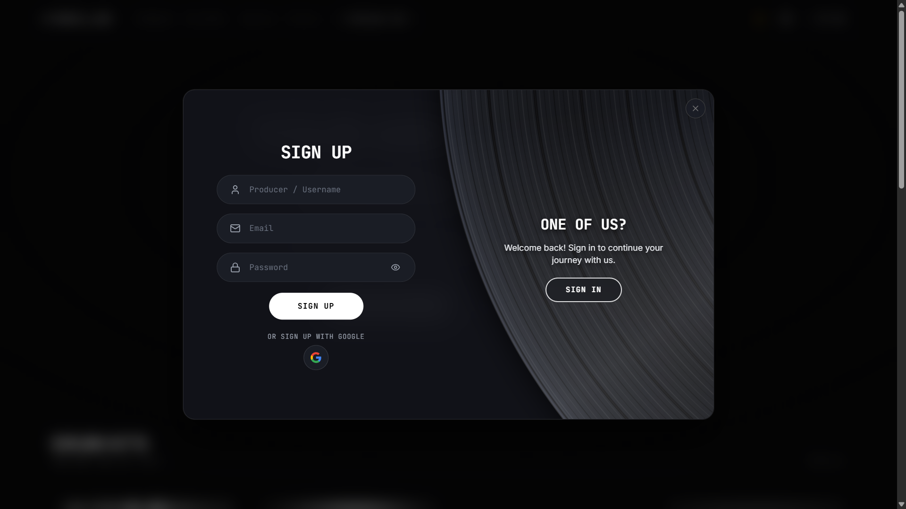
</p>
- Modal minimalista com efeito glassmorphism / blur.
- Fluxos completos de:
  - **Login** (validação de credenciais e armazenamento de token JWT).
  - **Cadastro** (validação estrita de senha com mínimo de 8 caracteres e alfanuméricos).
  - **Esqueci minha senha** e **Redefinição de senha com token**.

---

## 💻 Instalação e Execução

### Pré-requisitos
- [Node.js](https://nodejs.org/) versão `20.x` ou `22.x` (LTS recomendado).
- Gerenciador de pacotes `npm` (incluso com o Node.js).

### Passo a Passo

1. **Clone o repositório:**
   ```bash
   git clone https://github.com/guiSantos006/sonic-lab-front-end.git
   cd sonic-lab-front-end
   ```

2. **Instale as dependências:**
   ```bash
   npm install
   ```

3. **Configure as variáveis de ambiente:**
   Copie o arquivo de exemplo e ajuste as portas se necessário:
   ```bash
   cp .env.example .env
   ```

4. **Inicie o servidor de desenvolvimento:**
   ```bash
   npm run dev
   ```
   A aplicação estará acessível em: `http://localhost:3000` (ou na porta configurada pelo Vite).

5. **Para compilar o build de produção:**
   ```bash
   npm run build
   ```

6. **Para checar tipagem TypeScript:**
   ```bash
   npm run lint
   ```

---

## ⚙️ Variáveis de Ambiente

O arquivo `.env` pode ser configurado com os seguintes parâmetros:

| Variável | Descrição | Valor Padrão |
| :--- | :--- | :--- |
| `VITE_BACKEND_PORT` | Porta onde o servidor Spring Boot está rodando | `8080` |
| `VITE_BACKEND_URL` | URL base do backend (opcional se rodando local) | `http://localhost:8080` |

> **Nota:** Caso o backend não esteja ativo, o sistema iniciará normalmente com o modo integrado em memória/localStorage sem interromper a navegação.

---

## 📂 Estrutura de Pastas

```text
sonic-lab-front-end/
├── index.html                   # Entry point HTML com tema síncrono
├── metadata.json                # Metadados da aplicação
├── package.json                 # Dependências e scripts npm
├── tsconfig.json                # Configurações do TypeScript
├── vite.config.ts               # Configuração do Vite e proxies de API
│
├── docs/                        # Documentação e imagens
│   └── screenshots/             # Espaço reservado para as capturas de tela
│
└── src/
    ├── main.tsx                 # Inicialização do React DOM e ThemeProvider
    ├── App.tsx                  # Roteamento central, ErrorBoundary e modais
    ├── index.css                # Diretivas Tailwind v4 e estilos de paralaxe
    ├── types.ts                 # Interfaces TypeScript globais (Kit, Profile, etc.)
    ├── data.ts                  # Mock inicial e dados semente de Sound Kits
    │
    ├── context/
    │   └── ThemeContext.tsx     # Contexto e gerenciamento do tema Claro / Escuro
    │
    ├── components/
    │   ├── Navbar.tsx           # Barra de navegação com links e gatilhos
    │   ├── Footer.tsx           # Rodapé da aplicação com links e modais de info
    │   ├── HomeView.tsx         # Visão da página inicial (Hero e destaques)
    │   ├── CatalogView.tsx      # Catálogo com filtros avançados e busca
    │   ├── DetailsView.tsx      # Detalhes de um kit específico
    │   ├── SellView.tsx         # Formulário de publicação e venda de kits
    │   ├── ProfileView.tsx      # Perfil do produtor, meus kits e configurações
    │   ├── LoginView.tsx        # Gateway de login
    │   ├── RegisterView.tsx     # Gateway de cadastro
    │   ├── AuthSwitch.tsx       # Formulário modal dinâmico de autenticação
    │   ├── GlobalAudioPlayer.tsx# Barra de reprodução de áudio fixada no rodapé
    │   ├── Waveform.tsx         # Visualizador de áudio em barras Canvas
    │   ├── SonarGrid.tsx        # Malha interativa de radar em Canvas de fundo
    │   ├── ThemeToggle.tsx      # Botão minimalista de alternância de tema
    │   ├── VinylRecord.tsx      # Componente visual de vinil animado
    │   ├── Modals.tsx           # Modais de carrinho e informações institucionais
    │   └── ui/                  # Componentes base e efeitos (shaders, morphing)
    │
    └── utils/
        ├── audioPlayer.ts       # Singleton gerenciador do ciclo de áudio
        ├── authService.ts       # Serviço de autenticação REST + Fallback seguro
        └── soundKitService.ts   # CRUD de Sound Kits, geradores WAV e de capas
```

---

## 📄 Licença

Este projeto é disponibilizado sob a licença [Apache-2.0](https://www.apache.org/licenses/LICENSE-2.0).
